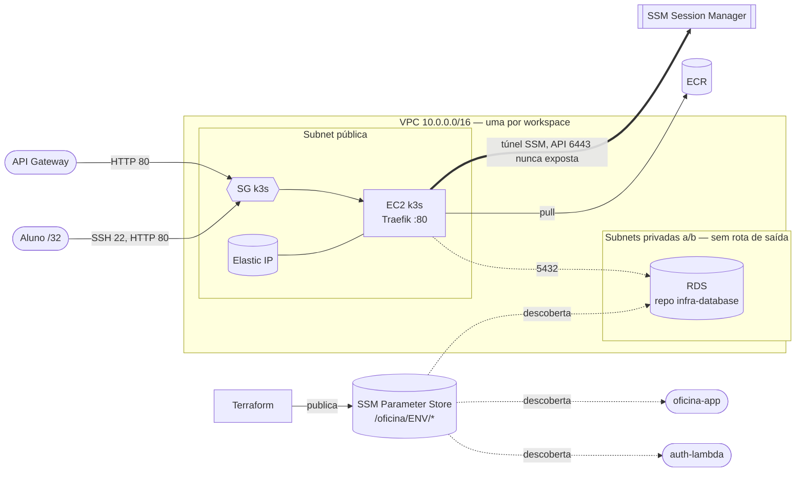

# oficina-infra-k8s

Infraestrutura base na AWS (Terraform) da Oficina Mecânica — Tech Challenge FIAP, Fase 3: VPC, EC2
com k3s, Elastic IP, ECR, security groups e o **contrato SSM** que os demais repositórios consomem.

Repositório criado na etapa E0 a partir do histórico de `oficina/infra/` do monorepo
[tech-challenge-fiap](https://github.com/victorduarte31/tech-challenge-fiap). O RDS vive em
[oficina-infra-database](https://github.com/victor-duarte-mendonca/oficina-infra-database).

## Tecnologias

Terraform ≥ 1.10 (backend S3 com `use_lockfile`), provider AWS 5.x, k3s (Kubernetes leve em uma EC2),
GitHub Actions, tflint e Trivy (IaC scan).

## Arquitetura



Decisões de rede e segurança: sem NAT Gateway (custo), IMDSv2 obrigatório com `hop_limit=1`, EBS
criptografado, porta 6443 nunca exposta, `allowed_cidr` proíbe `0.0.0.0/0`. A porta 80 aceita também as
faixas do API Gateway (`data "aws_ip_ranges"`). Achados do Trivy aceitos de propósito estão
justificados em [`.trivyignore`](.trivyignore).

## Ambientes e branches

Duas stacks **fisicamente separadas** (workspaces Terraform), cada uma com o seu state:

| Branch    | Environment   | Workspace | EC2         | Deploy                       |
|-----------|---------------|-----------|-------------|------------------------------|
| `homolog` | `homologacao` | `hml`     | `t3.small`  | automático no merge          |
| `main`    | `producao`    | `prod`    | `t3.medium` | automático, com aprovação    |

Fluxo: `feature/x` → PR para `homolog` → valida → PR `homolog` → `main`. `main` e `homolog` só recebem
merge por PR (squash) com os checks `validate` e `plan` verdes. A aprovação do ambiente `producao` é o
freio de custo: impede que um merge noturno suba uma stack que ficaria ligada sem ninguém olhando.

`hml` sobe **sob demanda**: só quando há mudança de infraestrutura ou de schema a ensaiar (security
group, `user_data`, parameter group, migration nova). O state fica em
`s3://oficina-tfstate-<account-id>/oficina/infra-k8s/<workspace>/terraform.tfstate`.

## Pré-requisitos

- Conta AWS Academy com a sessão ativa e `LabInstanceProfile` disponível.
- Terraform ≥ 1.10, AWS CLI v2, `gh` autenticado.
- Secrets publicados (os valores são seus; nada disto é commitado):
  - `AWS_ACCESS_KEY_ID`, `AWS_SECRET_ACCESS_KEY`, `AWS_SESSION_TOKEN` — expiram a cada sessão:
    ```bash
    export AWS_ACCESS_KEY_ID=... AWS_SECRET_ACCESS_KEY=... AWS_SESSION_TOKEN=...
    ./scripts/set-aws-session-secrets.sh
    ```
  - `ALLOWED_CIDR` — seu IP público em `/32` (secret de organização).
- O bucket de state é criado sozinho pela pipeline (e por `scripts/bootstrap-state-bucket.sh`).

## Execução local

O workspace `default` é inválido de propósito (`locals.tf`): selecione `hml` ou `prod`.

```bash
BUCKET="$(./scripts/bootstrap-state-bucket.sh)"
terraform init -backend-config="bucket=${BUCKET}"
terraform workspace select -or-create hml
export TF_VAR_allowed_cidr="$(curl -s https://checkip.amazonaws.com)/32"
terraform plan
```

Validação sem credenciais (é o que o job `validate` faz):

```bash
export TF_WORKSPACE=hml
terraform init -backend=false && terraform validate && terraform fmt -check -recursive
```

## Deploy

Pela pipeline (`.github/workflows/terraform.yml`):

| Job | Gatilho | O que faz |
|---|---|---|
| `validate` | push e PR | `fmt`, `validate`, `tflint`, `trivy config` |
| `plan` | PR | `terraform plan` no workspace do alvo (`homolog`→`hml`, `main`→`prod`) e comenta o plano no PR |
| `apply` | push em `homolog` / `main`; ou *Run workflow* com `confirm` vazio | `apply` no workspace correspondente; resumo com custo estimado |
| `destroy` | `workflow_dispatch` com `confirm` preenchido | exige digitar `destroy-<workspace>`; varredura de órfãos por tag ao final |

`plan` só executa com as credenciais da sessão e o `ALLOWED_CIDR`; sem eles passa com um `::notice::`.

### Dashboards, alertas e Synthetics (pasta `observability/`)

Raiz Terraform **separada** (state próprio em `oficina/observability/<workspace>`), provider `newrelic`:
2 dashboards a partir de JSON versionado (`dashboards/*.json.tftpl`), 6 políticas de alerta (8 condições NRQL)
roteadas por e-mail e um monitor Synthetics (ping a `GET <gateway>/health` a cada 5 min). Workflow
`Observability` (`.github/workflows/observability.yml`): `validate` em PR; `apply` em push ou manual.

- Secrets do environment: `NEW_RELIC_API_KEY` (User key `NRAK-...`, **não** é a licença de ingestão),
  `NEW_RELIC_ACCOUNT_ID` e `ALERT_EMAIL`. Sem eles, ou sem sessão AWS ativa, o apply é **ignorado com aviso**
  (verde sem ter aplicado: confira o `notice`). O disparo manual falha de propósito.
- A URL do gateway vem do SSM (`/oficina/<env>/api_gateway_url`); sem o gateway, o monitor e o alerta de
  disponibilidade não são criados.
- As consultas NRQL usam os nomes documentados de spans OTLP, métricas Prometheus e K8s samples; **confirmar
  com dados reais na sessão AWS** (spec 05 §10) e ajustar o JSON/`alerts.tf`.

## Contrato SSM publicado

Parâmetros *standard* (gratuitos), legíveis por qualquer identidade da conta. Evita
`terraform_remote_state`, que exigiria acesso ao state de outro módulo (o do banco guarda a senha).

| Parâmetro | Consumidor |
|---|---|
| `/oficina/<env>/vpc_id` | infra-database, auth-lambda |
| `/oficina/<env>/private_subnet_ids` | infra-database (subnet group), auth-lambda (VPC config) |
| `/oficina/<env>/k3s_security_group_id` | infra-database (ingresso 5432) |
| `/oficina/<env>/k3s_eip` | auth-lambda (integração do gateway) |
| `/oficina/<env>/ecr_repository_url` | oficina-app (build e deploy) |
| `/oficina/<env>/application_url` | oficina-app (smoke test), documentação |

`<env>` é `hml` ou `prod`.

## Ordem de bootstrap (por sessão)

1. `set-aws-session-secrets.sh`
2. **este repositório** → `apply` (VPC, EIP, ECR → SSM)
3. `oficina-infra-database` → `apply`
4. `oficina-app` → deploy
5. `oficina-auth-lambda` → deploy
6. **destroy na ordem inversa ao final da sessão.**

## Custo estimado

Valores aproximados (us-east-1, sob demanda), enquanto a stack estiver de pé:

| | `hml` | `prod` |
|---|---|---|
| EC2 | US$ 0,0208/h (`t3.small`) | US$ 0,0416/h (`t3.medium`) |
| IPv4 público | US$ 0,005/h | US$ 0,005/h |
| EBS gp3 20 GiB | ≈ US$ 0,002/h | ≈ US$ 0,002/h |
| **Total** | **≈ US$ 0,028/h** | **≈ US$ 0,049/h** |
| Sessão de 4 h | ≈ US$ 0,11 | ≈ US$ 0,20 |

SSM (parâmetros standard) e ECR (storage mínimo) não somam de forma relevante. O RDS tem custo
próprio no repositório `oficina-infra-database`.

## ⚠️ Destroy

**RDS, Elastic IP e API Gateway continuam cobrando após o "End Lab".** Ao fim de cada sessão rode o
workflow `Terraform` → *Run workflow* (Use workflow from: `homolog` para hml), escolha o workspace e digite em `confirm` `destroy-<workspace>`.
Depois confira os órfãos:

```bash
aws resourcegroupstaggingapi get-resources --tag-filters Key=Project,Values=oficina
```

## Fora de escopo

EKS, node group, Cluster Autoscaler, Multi-AZ do cluster, NAT Gateway e VPC endpoints (justificativa de
custo em `oficina-app/specs/00-visao-geral.md` §3). Os agentes de observabilidade (`nri-bundle`) entram
na etapa E7, pois exigem um cluster já no ar.
